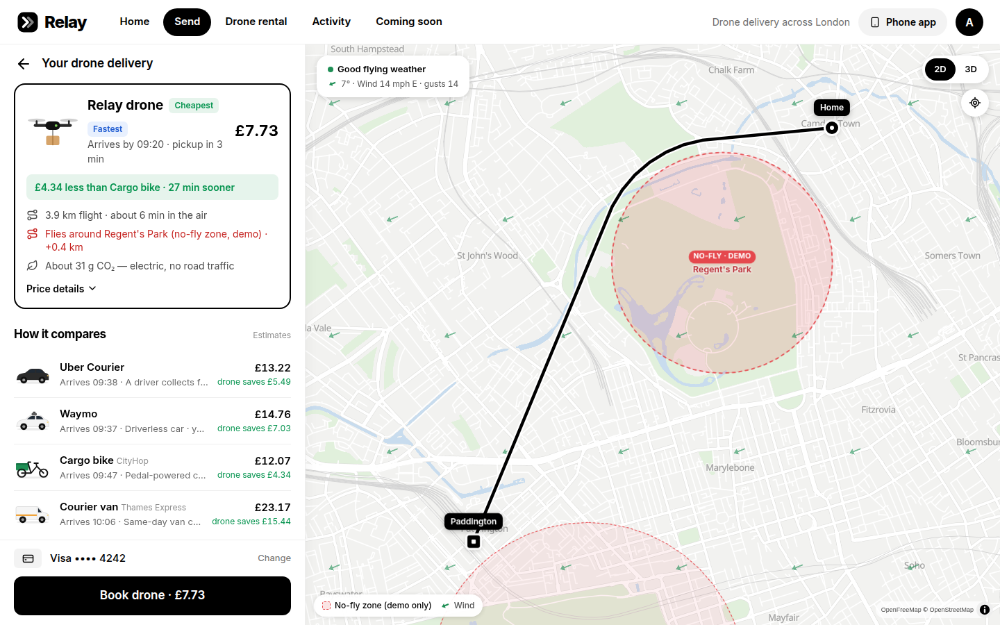
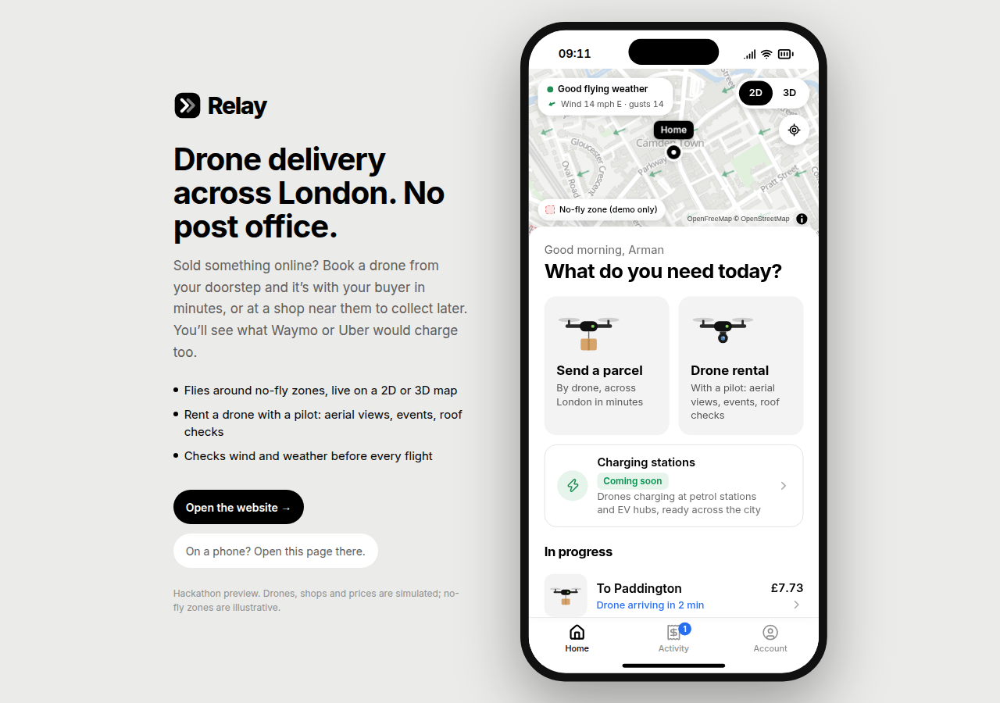
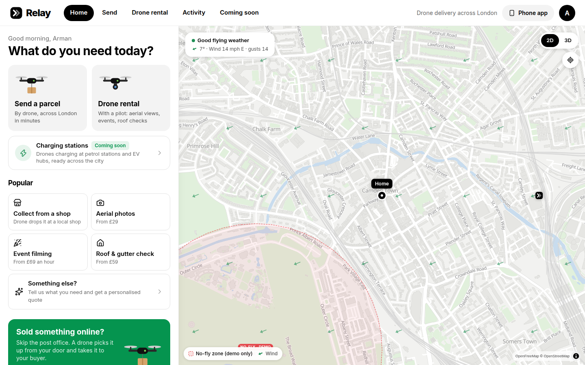
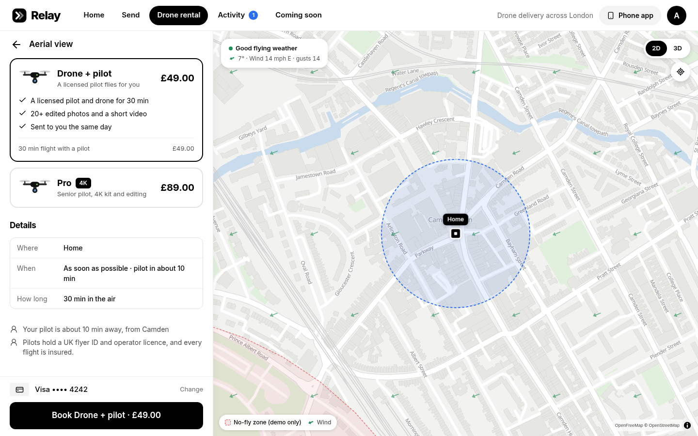

<p align="center">
  
</p>

<p align="center">
  Drone delivery and drone rental across London — a one-day hackathon prototype.
</p>

<p align="center">
  No download needed. Just tap a button to try it.
</p>

<p align="center">
  <a href="https://tanvirtually.github.io/relay/"></a>
  &nbsp;&nbsp;
  <a href="https://tanvirtually.github.io/relay/mobile/"></a>
</p>

<p align="center">
  <a href="https://github.com/tanvirtually/relay/actions/workflows/pages.yml"></a>
  
  
  
  
</p>

<p align="center">
  
</p>

<p align="center">
  
</p>

## The problem

Getting a small parcel across London still usually means a post office queue, a van, or a courier sitting in traffic. A drone can do the same trip in minutes, but only if the route stays outside no-fly zones and the wind is safe enough to fly.

Relay is a rough sketch of that booking flow, built in one day. It also covers hiring a pilot and a drone for aerial photos, an event, or a roof and gutter check.

## What it does

- 📦 **Send a parcel** across London. Home is pre-filled; search any area or a UK postcode.
- 🚪 **To the door, or a partner shop.** The drone lowers the parcel on a line, or a nearby corner shop holds it for collection. Collect is £1 cheaper in the demo.
- 🗺️ **Routes around no-fly zones.** The line is the shortest path that stays outside the demo zones, with a margin. A pickup or drop inside a zone is refused.
- 💨 **Wind check** before take-off. Too windy and the drone stays on the ground. Breezy just slows it down.
- 💷 **Price comparison** against rough estimates for Waymo, Uber Courier, a cargo bike and a courier van.
- 🎥 **Drone rental** with a pilot: aerial views, events, roof checks, or a job you describe (you get an estimate, then a personalised quote).
- 🔋 **Charging stations**, marked coming soon: illustrative pads at petrol stations and EV hubs. Nothing here is a real site.

<p align="center">
  
</p>

<p align="center">
  
</p>

## How it works

The same screens run as a website and as a phone app.

1. You pick a pickup and a drop in London, a size, and whether it is fragile.
2. The browser plans a route around the bundled demo airspace and tall buildings, then prices the drone and the four comparison options.
3. Booking starts a simulated flight (about 24× faster than real time). “Demo: skip ahead” jumps to the next step.
4. Rental follows the same idea: purpose, place, package, then a simulated pilot and flight.

Screens are `Home`, `Send`, `Prices`, `Track`, `Rent`, `RentOptions`, `RentTrack`, `Coming soon`, `Activity` and `Account`. In-app links use the URL hash (`/#/send`), so a static host does not have to rewrite paths. `404.html` is a copy of the website, for a direct visit to an unknown path.

The optional API on port 8787 is only there to keep future Uber Direct and Waymo keys off the browser. The booking screens do not call it. Quotes, routes, shops and rentals are computed in the page from bundled data. On GitHub Pages that is the whole app.

Live weather comes from [Open-Meteo](https://open-meteo.com/) and postcodes from [postcodes.io](https://postcodes.io/) when those free services answer. If they do not, the app uses a built-in weather estimate and bundled London postcode districts. The map uses [OpenFreeMap](https://openfreemap.org/) vector tiles (no API key). If the tiles cannot be loaded, a bundled London outline is shown instead, with a simple 3D skyline.

## Tech stack

| Piece | What we used |
|---|---|
| UI | React 19, TypeScript, Tailwind 4, Vite 8 |
| Map | MapLibre GL, deck.gl, OpenFreeMap |
| State | Zustand (saved in the browser) |
| Weather & places | Open-Meteo, postcodes.io, plus bundled fallbacks |
| Optional API | Express 5 on `:8787` (not used by the static site) |

## Run locally

Node 20.19 or newer (22 is what `.nvmrc` pins). No API keys.

```bash
npm install
npm run dev          # website on http://localhost:5173 and API on :8787
```

| URL | What you get |
|---|---|
| http://localhost:5173/ | Website: booking panel on the left, map on the right |
| http://localhost:5173/mobile/ | Phone app, shown in a phone frame on a laptop |

`npm run dev:web` runs the website on its own. `npm run dev:phone` prints a network address so a phone on the same Wi-Fi can open `/mobile/`.

```bash
npm run build        # production build at /
npm start            # API serves that build on :8787
npm run build:pages  # same build, base path /relay/, for GitHub Pages
```

`npm run dev` is unchanged by the Pages base path. Set `VITE_BASE` only for the static deploy (`build:pages` does that).

## Try the demo

1. **Send a parcel**, deliver to Paddington. The line bends around Regent’s Park (a demo no-fly zone).
2. **See prices**, then book. “Demo: skip ahead” walks the flight.
3. Try Canary Wharf as the drop. It sits inside a zone; the app offers a shop outside it.
4. **Drone rental → Event filming**. Options stay disabled until you set the event length.
5. **Account → Demo controls → Storm** grounds the drones. **Calm** clears a windy day.

## Limits of this prototype

This was built in a day. Please treat it as a demo.

- Drones, pilots, shops, tracking, photos, films, roof reports and payments are simulated.
- No-fly zones are illustrative. They are not NATS or CAA data and must not be used for real flight planning.
- The aircraft (“Relay Skylift H5”) is fictional: a 45 × 35 × 25 cm bay, 5 kg, 55 km/h, 90 m cruise.
- Waymo and Uber prices are estimates. Those APIs are not connected. CityHop and Thames Express are made-up names.
- Partner shops and the “coming soon” charging sites are generated or illustrative.
- There is no licence file in this repository yet.

## Team

Built by team T14 at Problem Day.

- Mohammed Fahmy
- Kushalini Paul
- Seva Kolesnik
- [Arman Bayatmaku](https://github.com/ArmanBayatmaku)
- [Tanvir Hossain Parvin](https://github.com/tanvirtally)

## Acknowledgements

Built at #ProblemDay, a hackathon by Kickstart Global, on 31 October 2026.

This repo is a fork of [ArmanBayatmaku/Theproblemday](https://github.com/ArmanBayatmaku/Theproblemday), renamed to Relay.

Map data © [OpenStreetMap](https://www.openstreetmap.org/copyright) contributors, via OpenFreeMap.
